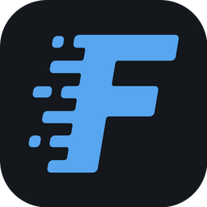

<div align="center">



# FreeToken

**Run large Mixture-of-Experts language models on a local NVIDIA GPU**

[](https://snapcraft.io/freetoken)
[](https://snapcraft.io/core24)

[](https://snapcraft.io/publisher/sidaliteir)


[Getting Started](#getting-started) · [Configure](#configure) · [Limitations](#limitations) · [Build](#build) · [Support](#support) · [License](#license)

Unofficial snap packaging for [FreeToken](https://github.com/FlashML-org/FreeToken), an edge-native Mixture-of-Experts serving engine with OpenAI and Anthropic-compatible HTTP APIs.

</div>

---

## Getting Started

<a href="https://snapcraft.io/freetoken"></a>

For a graphical interface, [freetoken-desktop](https://snapcraft.io/freetoken-desktop) can use the shared backend below.

Local inference needs an NVIDIA GPU (RTX 30 series or newer) with driver 580 or newer. Install the snap with its CUDA component:

```bash
sudo snap set system experimental.user-daemons=true
sudo snap install freetoken+cuda
freetoken serve --model Qwen/Qwen3.6-35B-A3B --port 1919
```

The user-daemons flag is required to install this snap because it includes an optional user service, even when that service is disabled.

The server listens on `http://127.0.0.1:1919`. In a second terminal, chat with it or query it:

```bash
freetoken shell
freetoken ctl stats
```

Point any OpenAI or Anthropic-compatible client at `http://127.0.0.1:1919`. Stop the server with `Ctrl+C`.

For a remote server, install only `freetoken` and run `freetoken shell --server http://SERVER:1919`; the CUDA component is unnecessary.

To convert a Hugging Face checkpoint to FreeToken's FTW format:

```bash
freetoken checkpoint --model ~/models/<hf-dir> --out ~/models/<ftw-dir>
```

## Configure

Models downloaded from Hugging Face or ModelScope, and the Triton and CUDA caches, are kept under `~/snap/freetoken/common`, so they survive snap refreshes. Local models can be read from your home directory.

Some features need an interface that is not connected automatically:

| Feature | Command |
| --- | --- |
| Models on USB drives and other removable media (`/media`, `/mnt`) | `sudo snap connect freetoken:removable-media` |

### Background service

The snap includes an optional system service, disabled by default. Enabling it installs the CUDA component if needed:

```bash
sudo snap set freetoken daemon.model=Qwen/Qwen3.6-35B-A3B daemon.enabled=true
```

| Key | Default | Description |
| --- | --- | --- |
| `daemon.enabled` | `false` | Start the service at boot and now |
| `daemon.model` | (unset) | Hugging Face model ID or local model directory |
| `daemon.host` | `127.0.0.1` | `127.0.0.1` or `0.0.0.0` |
| `daemon.port` | `1919` | Listening port |
| `daemon.api-key` | (unset) | API key required on every request; mandatory with `daemon.host=0.0.0.0` |

The service runs as root and keeps its downloads in `/var/snap/freetoken/common`. It cannot read home directories: put local models in `/var/snap/freetoken/common/models`, or on removable media once `removable-media` is connected. Follow its logs with `sudo snap logs -f freetoken.daemon`, and disable it with `sudo snap set freetoken daemon.enabled=false`.

### Desktop backend

The optional backend lets FreeToken Desktop use this snap's engine and CUDA component. It runs as your desktop user and waits for the desktop to select a model.

```bash
sudo snap set freetoken daemon.enabled=false
sudo install -d -m 0700 -o "$(id -u)" -g "$(id -g)" \
  /var/snap/freetoken/common/server /var/snap/freetoken/common/models
snap start --user --enable freetoken.backend
```

Run the last command without `sudo`. This setup is for one desktop user; use the system service above for unattended operation. Existing model files retain their ownership.

| Key | Default | Description |
| --- | --- | --- |
| `backend.port` | `1900` | Local management port, from 1024 to 65535; restart with `snap restart --user freetoken.backend` after changing it |

Connect the desktop using its [shared backend instructions](https://github.com/sidalit/freetoken-desktop-snap#shared-backend). It downloads models into `/var/snap/freetoken/common/models`; a private token authenticates management requests. Stop the backend and its engine with `snap stop --user --disable freetoken.backend`.

## Limitations

- Only NVIDIA GPUs on amd64 are supported.
- For multiple GPUs, pass `--disable-pynccl` to `freetoken serve`. This uses PyTorch's NCCL backend; the custom PyNCCL backend requires a CUDA compiler at runtime, which is not included.
- `freetoken launch` is unavailable: the strict snap cannot install or configure coding agents on the host. Start the server and point your agent at its HTTP API instead.
- Files outside your home directory and, once connected, removable media are inaccessible. Hidden folders directly under your home directory are not read either, so an existing `~/.cache/huggingface` cache is not reused; models are downloaded again into the snap's own cache.
- Local inference still needs roughly 3 GB across the snap and CUDA component. Models are downloaded separately.

## Build

```bash
git clone https://github.com/sidalit/freetoken-snap.git
cd freetoken-snap
sudo snap install snapcraft --classic
snapcraft pack
```

Builds use upstream's prebuilt engine and CUDA-kernel wheels: the selected release for beta, or the latest nightly for edge, versioned with its commit.

## Support

- **Installation or snap issues:** [open a packaging issue](https://github.com/sidalit/freetoken-snap/issues).
- **Application bugs:** [report them upstream](https://github.com/FlashML-org/FreeToken/issues).

## License

Snap packaging: [MIT](https://github.com/sidalit/freetoken-snap/blob/main/LICENSE).
